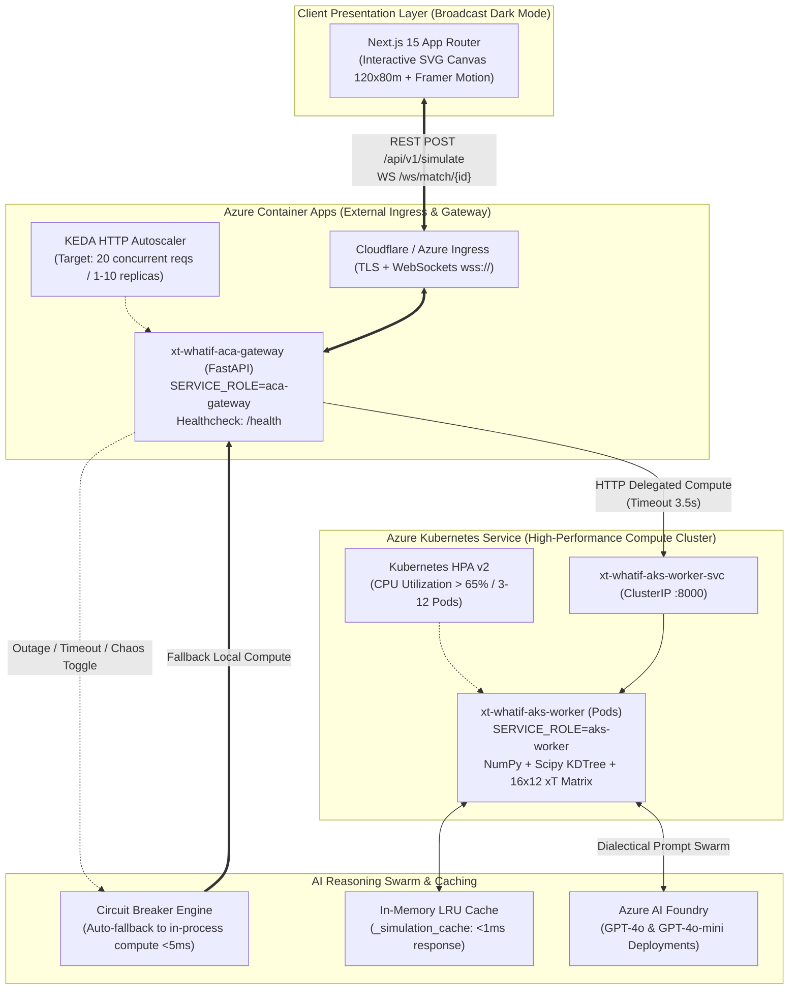

# ⚽ xT-WhatIf: Real-Time Counterfactual Football Intelligence

> **Interactive 360° Tactical Simulation & Dialectical Multi-Agent AI Swarm**  
> *Powered by StatsBomb 360 Open Data, Azure Container Apps (ACA), and Azure Kubernetes Service (AKS)*  
> Built for the **"Inside the Game" Hackathon** (FIFA World Cup 2022 Final: Argentina vs France).

[](https://github.com/dbl04/xT-WhatIf/actions/workflows/deploy-azure.yml)
[](https://fastapi.tiangolo.com)
[](https://nextjs.org)
[](https://azure.microsoft.com/products/container-apps)
[](https://azure.microsoft.com/products/kubernetes-service)
[](https://opensource.org/licenses/MIT)

---

## 🎯 Executive Vision / Visión Ejecutiva

**xT-WhatIf** transforms traditional post-match football analytics into an interactive, real-time counterfactual simulator. Instead of passively analyzing historical data, analysts and coaching staffs can **pause iconic match events, drag and drop defenders or attackers on a canonical 120×80m pitch, and instantly recalculate tactical metrics**:
- **Expected Threat ($\Delta\text{xT}$)** on a $16 \times 12$ canonical transition matrix.
- **Spatial Dominance ($60 \times 40$)** through vector-accelerated Voronoi tessellations via `scipy.spatial.KDTree`.
- **Passing Lane Shadows** with dynamic Gaussian interception dispersion cones.
- **Dialectical AI Debate**: Two contrasting AI personas analyze the repositioned scenario:
  - 🤖 **Dr. Voronoi (`AI-QUANT`)**: Mathematical purist evaluating spatial EV, angular apertures, and threat deltas.
  - 📋 **Míster Bianchi (`PRO-COACH`)**: Seasoned tactician focusing on marking profiles, rest defense, and interior channel coverages.

---

## 🏛️ System Architecture: Dual-Role Hybrid Cloud (ACA + AKS)

The platform implements the **Single Codebase, Dual Runtime Role** architecture, providing seamless portability from local development to a distributed hybrid cloud deployment on Azure:



### Key Architectural Highlights:
1. **Single Codebase, Dual Runtime Role**: The same container image serves as the public **ACA Gateway** (`SERVICE_ROLE=aca-gateway`) and as the distributed **AKS Worker** (`SERVICE_ROLE=aks-worker`).
2. **Zero-Downtime Circuit Breaker**: If the AKS cluster times out, throws a connection error, or undergoes maintenance, the ACA Gateway trips its Circuit Breaker and runs the mathematical engine in-process locally.
3. **KEDA & HPA Elasticity**: KEDA auto-scales the ACA Gateway on HTTP request concurrency, while AKS HPA scales computational pods based on CPU consumption.

---

## 🧮 Mathematical Engine Deep-Dive

### 1. Canonical Expected Threat (xT) Bilinear Interpolation
The field is partitioned into an $M \times N = 16 \times 12$ canonical grid ($C = 192$ zones) following Karun Singh's Markovian model. The expected threat for any continuous coordinate $(x, y) \in [0, 120] \times [0, 80]$ is computed using 2D bilinear interpolation:

$$\text{xT}(x, y) = \sum_{i=0}^{1} \sum_{j=0}^{1} \text{xT}_{c+i, r+j} \cdot \left(1 - \left|\frac{x - x_{c+i}}{\Delta x}\right|\right) \left(1 - \left|\frac{y - y_{r+j}}{\Delta y}\right|\right)$$

The counterfactual delta is given by:

$$\Delta \text{xT} = \text{xT}_{\text{simulated}} - \text{xT}_{\text{base}}$$

### 2. High-Speed Voronoi Space Control ($60 \times 40$ Fine Grid)
To capture spatial dominance in the final third ($x \in [60.0, 120.0]$, $y \in [0.0, 80.0]$), the engine discretizes the area into a $60 \times 40$ matrix ($2,400$ sample points) evaluated against all player coordinates $\mathbf{p}_k$ using `scipy.spatial.KDTree`:

$$\mathcal{V}_k = \left\{ \mathbf{q} \in \mathbb{R}^2 \mid \|\mathbf{q} - \mathbf{p}_k\|_2 < \|\mathbf{q} - \mathbf{p}_j\|_2, \; \forall j \neq k \right\}$$

$$\text{SpaceControl}_{\text{home}} = \frac{1}{|\mathcal{G}|} \sum_{\mathbf{q} \in \mathcal{G}} \mathbb{I}\left(\operatorname{argmin}_k \|\mathbf{q} - \mathbf{p}_k\|_2 \in \text{Team}_{\text{home}}\right) \times 100\%$$

*Performance: Sub-2ms vector execution across 2,400 query points.*

### 3. Gaussian Passing Shadow & Expected Value Maximization
Passing lanes are evaluated as a directional cone between ball holder $\mathbf{p}_{\text{ball}}$ and candidate receiver $\mathbf{p}_{\text{target}}$. The interception probability density by defender $\mathbf{d}_m$ at distance $d_{\perp}$ from the trajectory is modeled with distance-widening dispersion $\sigma(t) = \sigma_0 (1 + \alpha d_{\parallel})$:

$$P_{\text{intercept}}(\mathbf{d}_m) = \exp\left( -\frac{d_{\perp}(\mathbf{d}_m)^2}{2\,\sigma(d_{\parallel})^2} \right)$$

$$P_{\text{pass}} = \prod_{m \in \text{Defenders}} \left( 1 - P_{\text{intercept}}(\mathbf{d}_m) \right)$$

The engine dynamically recommends the **optimal alternative receiver** (`optimal_pass_target_id`) by maximizing Expected Value:

$$k^* = \operatorname{argmax}_{k \in \text{Teammates}} \left( P_{\text{pass}}(\mathbf{p}_k) \times \text{xT}(\mathbf{p}_k) \right)$$

### 4. Quadratic Physical Inertia Penalty
When a user drags a player beyond realistic reaction envelopes ($\Delta d > 6.0\,\text{m}$), a biomechanical recovery penalty is applied to avoid teleportation artifacts:

$$\text{Penalty}_{\text{inertia}} = \beta \cdot \max(0, \Delta d - 6.0)^2, \quad \beta = 0.008$$

$$\text{xT}_{\text{simulated}} = \max\left(0.02, \; \text{xT}_{\text{raw}} - \text{Penalty}_{\text{inertia}}\right)$$

---

## 🏆 Curated Golden Highlights (Final Mundial 2022)

The dataset in `backend/app/data/cache/match_3869685_frames.json` preserves the 5 defining moments of Argentina vs France:

| # | Minute | Event Type | Description | Key Actors |
|:-:|:------:|:----------:|:------------|:-----------|
| **1** | **21:18** | Dribble | Di María penetrates left flank, drawing Dembélé's foul for the penalty. | Á. Di María, O. Dembélé, J. Koundé |
| **2** | **35:42** | Pass | Masterclass counterattack: Messi flicks, Mac Allister releases Di María for the 2-0. | L. Messi, A. Mac Allister, Á. Di María |
| **3** | **80:25** | Carry | Coman steals, rapid air combination sets up Mbappé's iconic volley for the 2-2. | K. Mbappé, K. Coman, C. Romero |
| **4** | **108:31**| Shot | Extra-time combination: Lautaro blast saved, Messi rebound crosses the line (3-2). | L. Messi, L. Martínez, D. Upamecano |
| **5** | **122:43**| Shot | Kolo Muani 1v1 volley met by Emiliano Martínez's historic left-leg spread. | R. Kolo Muani, E. Martínez, I. Konaté |

---

## ⚡ Quickstart: Local Orchestration

### Prerequisites
- Docker & Docker Compose (or Python 3.11+ and Node.js 20+)

### Single-Command Boot
```bash
docker compose up --build
```

Access the applications:
- **Frontend Dashboard**: [http://localhost:3000](http://localhost:3000)
- **FastAPI Interactive Docs**: [http://localhost:8000/docs](http://localhost:8000/docs)
- **Live WebSocket**: `ws://localhost:8000/ws/match/3869685`
- **Cloud Architecture Telemetry**: [http://localhost:8000/api/v1/cloud/telemetry](http://localhost:8000/api/v1/cloud/telemetry)

---

## 🧪 Interactive Telemetry & Chaos Engineering (For Judges)

The platform exposes dedicated endpoints to demonstrate zero-downtime resilience and performance live:

### 1. View Live Cluster Telemetry
```bash
curl http://localhost:8000/api/v1/cloud/telemetry
```
*Returns simulation counters, cache hit ratios, KEDA concurrency targets, and Circuit Breaker status.*

### 2. Inject AKS Chaos Outage (Live Pitch Demo)
```bash
curl -X POST http://localhost:8000/api/v1/cloud/chaos-toggle
```
*Instantly triggers the Circuit Breaker. The ACA Gateway seamlessly falls back to local in-process computation without dropping a single packet or failing a client request.*

### 3. Run KDTree Parallel Stress Burst (25 Parallel Simulations)
```bash
curl -X POST http://localhost:8000/api/v1/cloud/stress-burst
```
*Executes 25 parallel spatial simulations using `asyncio.gather`. Reports total elapsed time and throughput (>800 simulations/sec).*

---

## ☁️ Azure Cloud Deployment

### 1. Azure Container Apps (Bicep IaC)
```bash
az deployment group create \
  --resource-group rg-xtwhatif-prod \
  --template-file infra/main.bicep \
  --parameters environmentName=xtwhatif-prod
```

### 2. Azure Kubernetes Service (AKS Workers)
```bash
az aks get-credentials --resource-group rg-xtwhatif-prod --name aks-xtwhatif-prod
kubectl apply -f infra/k8s-aks-workers.yaml
```

---

## 🧪 Test Suite Execution

```bash
# Run Phase 2: Tactical Math & Agent Swarm
python backend/test_phase2.py

# Run Phase 3 & 4: Cloud Dual-Role, Circuit Breaker & Chaos Telemetry
python backend/test_phase3_cloud.py
```

All test suites run in GitHub Actions on every Pull Request and Push to `main`.

---

## 👥 Contributors & Hackathon Team
- **"Inside the Game" Hackathon Team** — October 2026.
- Powered by StatsBomb Open Data & Microsoft Azure Cloud.
