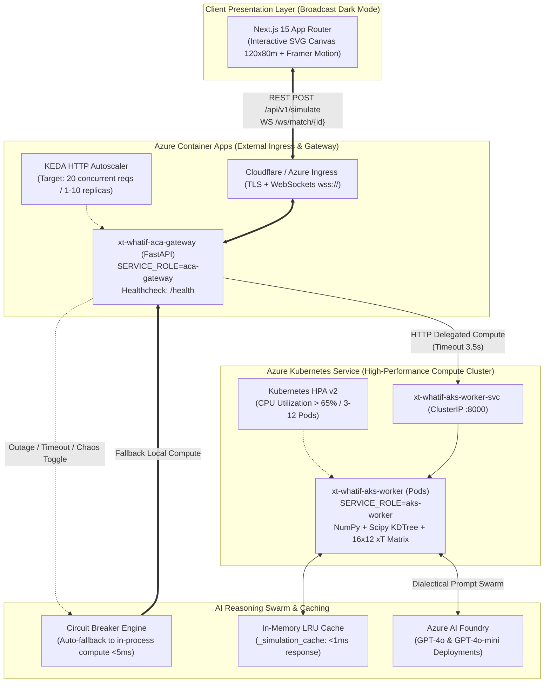

# ⚽ xT-WhatIf: Real-Time Counterfactual Football Intelligence

> **Interactive 360° Tactical Simulation & Dialectical Multi-Agent AI Swarm**  
> *Powered by a seeded synthetic 360-style match generator, Azure Container Apps (ACA), and Azure Kubernetes Service (AKS)*  
> Built for the **"Inside the Game" Hackathon** (Microsoft × Premier League). All match data is synthetic: fictional clubs, players and moments.

[](https://github.com/dbl04/xT-WhatIf/actions/workflows/deploy-azure.yml)
[](https://fastapi.tiangolo.com)
[](https://nextjs.org)
[](https://azure.microsoft.com/products/container-apps)
[](https://azure.microsoft.com/products/kubernetes-service)
[](https://opensource.org/licenses/MIT)

---

## 🎯 Executive Vision

**xT-WhatIf** transforms traditional post-match football analytics into an interactive, real-time counterfactual simulator. Instead of passively analyzing what happened, analysts and coaching staffs can **pause key match moments, drag and drop defenders or attackers on a canonical 120×80m pitch, and instantly recalculate tactical metrics**:
- **Expected Threat ($\Delta\text{xT}$)** on a $16 \times 12$ canonical transition matrix.
- **Spatial Dominance ($60 \times 40$)** through vector-accelerated Voronoi tessellations via `scipy.spatial.KDTree`.
- **Passing Lane Shadows** with dynamic Gaussian interception dispersion cones.
- **Dialectical AI Debate**: Two contrasting AI personas analyze the repositioned scenario:
  - 🤖 **Dr. Voronoi (`AI-QUANT`)**: Mathematical purist evaluating spatial EV, angular apertures, and threat deltas.
  - 📋 **Coach Bianchi (`PRO-COACH`)**: Seasoned tactician focusing on marking profiles, rest defense, and interior channel coverages.
- **Personalised storytelling**: the whole interface and both pundits speak **English or Spanish**, and the commentary is rewritten for four audiences (casual fan, analyst, coach, audio description). See *Personalisation: Language & Audience* below.

---

## 🏛️ System Architecture: Dual-Role Hybrid Cloud (ACA + AKS)

The platform implements the **Single Codebase, Dual Runtime Role** architecture, providing seamless portability from local development to a distributed hybrid cloud deployment on Azure:



### Key Architectural Highlights:
1. **Single Codebase, Dual Runtime Role**: The same container image serves as the public **ACA Gateway** (`SERVICE_ROLE=aca-gateway`) and as the distributed **AKS Worker** (`SERVICE_ROLE=aks-worker`).
2. **Zero-Downtime Circuit Breaker**: If the AKS cluster times out, throws a connection error, or undergoes maintenance, the ACA Gateway trips its Circuit Breaker and runs the mathematical engine in-process locally.
3. **KEDA & HPA Elasticity**: KEDA auto-scales the ACA Gateway on HTTP request concurrency, while AKS HPA scales computational pods based on CPU consumption.

---

## 🧮 Mathematical Engine Deep-Dive

### 1. Canonical Expected Threat (xT) Bilinear Interpolation
The field is partitioned into an $M \times N = 16 \times 12$ canonical grid ($C = 192$ zones) following Karun Singh's Markovian model. The expected threat for any continuous coordinate $(x, y) \in [0, 120] \times [0, 80]$ is computed using 2D bilinear interpolation:

$$\text{xT}(x, y) = \sum_{i=0}^{1} \sum_{j=0}^{1} \text{xT}_{c+i, r+j} \cdot \left(1 - \left|\frac{x - x_{c+i}}{\Delta x}\right|\right) \left(1 - \left|\frac{y - y_{r+j}}{\Delta y}\right|\right)$$

The counterfactual delta is given by:

$$\Delta \text{xT} = \text{xT}_{\text{simulated}} - \text{xT}_{\text{base}}$$

### 2. High-Speed Voronoi Space Control ($60 \times 40$ Fine Grid)
To capture spatial dominance in the final third ($x \in [60.0, 120.0]$, $y \in [0.0, 80.0]$), the engine discretizes the area into a $60 \times 40$ matrix ($2,400$ sample points) evaluated against all player coordinates $\mathbf{p}_k$ using `scipy.spatial.KDTree`:

$$\mathcal{V}_k = \left\{ \mathbf{q} \in \mathbb{R}^2 \mid \|\mathbf{q} - \mathbf{p}_k\|_2 < \|\mathbf{q} - \mathbf{p}_j\|_2, \; \forall j \neq k \right\}$$

$$\text{SpaceControl}_{\text{home}} = \frac{1}{|\mathcal{G}|} \sum_{\mathbf{q} \in \mathcal{G}} \mathbb{I}\left(\operatorname{argmin}_k \|\mathbf{q} - \mathbf{p}_k\|_2 \in \text{Team}_{\text{home}}\right) \times 100\%$$

*Performance: Sub-2ms vector execution across 2,400 query points.*

### 3. Gaussian Passing Shadow & Expected Value Maximization
Passing lanes are evaluated as a directional cone between ball holder $\mathbf{p}_{\text{ball}}$ and candidate receiver $\mathbf{p}_{\text{target}}$. The interception probability density by defender $\mathbf{d}_m$ at distance $d_{\perp}$ from the trajectory is modeled with distance-widening dispersion $\sigma(t) = \sigma_0 (1 + \alpha d_{\parallel})$:

$$P_{\text{intercept}}(\mathbf{d}_m) = \exp\left( -\frac{d_{\perp}(\mathbf{d}_m)^2}{2\,\sigma(d_{\parallel})^2} \right)$$

$$P_{\text{pass}} = \prod_{m \in \text{Defenders}} \left( 1 - P_{\text{intercept}}(\mathbf{d}_m) \right)$$

The engine dynamically recommends the **optimal alternative receiver** (`optimal_pass_target_id`) by maximizing Expected Value:

$$k^* = \operatorname{argmax}_{k \in \text{Teammates}} \left( P_{\text{pass}}(\mathbf{p}_k) \times \text{xT}(\mathbf{p}_k) \right)$$

### 4. Quadratic Physical Inertia Penalty
When a user drags a player beyond realistic reaction envelopes ($\Delta d > 6.0\,\text{m}$), a biomechanical recovery penalty is applied to avoid teleportation artifacts:

$$\text{Penalty}_{\text{inertia}} = \beta \cdot \max(0, \Delta d - 6.0)^2, \quad \beta = 0.008$$

$$\text{xT}_{\text{simulated}} = \max\left(0.02, \; \text{xT}_{\text{raw}} - \text{Penalty}_{\text{inertia}}\right)$$

---

## 🧪 Synthetic Match Data

All data is **synthetic and football-realistic**, generated by [`backend/app/services/synthetic_generator.py`](backend/app/services/synthetic_generator.py). No real clubs, players or match feeds are used.

- **Fixture:** Redmoor Albion vs Saltmarsh Rovers (fictional), match id `900001`, seed `7`. Same seed, same match.
- **Full freeze-frames:** all 22 players plus the ball in every moment, in 120×80 coordinates with the team in possession attacking towards x = 120.
- **Role-based shapes:** the attacking side sets up in a 4-3-3 (rest-defence centre-backs, high full-backs, wingers holding width, striker on the last line); the defending side in a compact 4-5-1 block that stays goal-side and shifts towards the ball.
- **Scenario templates:** wide carry, counter-attack through ball, cut-back, half-space pass, switch of play, edge-of-box shot and 1v1. Each fixes the ball path and which roles carry and receive.
- **Realistic details:** the nearest defender presses the carrier at an angle, the action is played through a gap (defenders are kept off the ball's path), Gaussian positional noise and a 1.8 m minimum spacing.
- **Consistent metrics:** xT, pass probability and space control are computed with the same engine used for counterfactuals, so an untouched moment always has ΔxT = 0.

Moments in the default match:

| # | Clock | Event | Moment | In possession | Base xT |
|:-:|:-----:|:-----:|:-------|:--------------|:-------:|
| **1** | **5:03** | Shot | Shot from the edge of the box | Saltmarsh Rovers (I. Kowalin) | 0.10 |
| **2** | **19:10** | Shot | One-on-one with the keeper | Saltmarsh Rovers (Z. Ombrell) | 0.11 |
| **3** | **37:09** | Pass | Switch of play to the far side | Redmoor Albion (D. Okonne) | 0.09 |
| **4** | **45:19** | Dribble | Wide carry into the box | Redmoor Albion (E. Adeyo) | 0.18 |
| **5** | **55:12** | Pass | Through ball into the half-space | Redmoor Albion (M. Ferrant) | 0.25 |
| **6** | **71:48** | Pass | Counter-attack: ball into space | Saltmarsh Rovers (I. Kowalin) | 0.22 |
| **7** | **86:56** | Pass | Cut-back from the byline | Saltmarsh Rovers (Y. Belcourt) | 0.17 |

Regenerate the committed fixtures (backend cache, frontend offline mocks and the offline narration for every language and audience) after changing the generator or the narration:

```bash
cd backend && python -m app.services.synthetic_generator --write
```

`backend/test_synthetic_generator.py` checks determinism, squad and pitch invariants, plausible metrics, and that the committed fixtures are up to date.

---

## 🗣️ Personalisation: Language & Audience

The challenge asks to *personalize* the explanation. xT-WhatIf does it on two axes, chosen at the top right of the dashboard and remembered per browser:

| Axis | Options | What changes |
|:-----|:--------|:-------------|
| **Language** | English (default) · Spanish | Every interface string, the moment names, both pundits' debate, the exported PNG report and the commentator voices (`en-GB` / `es-ES`). |
| **Audience** | Casual fan · Analyst (default) · Coach · Audio description | How the pundits explain the same numbers. |

- **Casual fan:** plain words, no jargon; xT is told as *"a 10% chance of leading to a goal"*.
- **Analyst:** full metrics — xT on the 16×12 grid, pass probability, Voronoi space control, coordinates.
- **Coach:** a verdict on the adjustment (*validated* / *rejected*) and one actionable coaching point.
- **Audio description:** spoken-first, spatial narration for blind and low-vision fans (*"on the right wing, about 25 metres from goal"*), no symbols or coordinates, read about 10% slower.

**Code calculates, AI explains.** All wording lives in [`backend/app/services/narration.py`](backend/app/services/narration.py) and is filled only with numbers computed by the engine. With Azure OpenAI configured, the same profile is turned into style instructions for GPT-4o, which is told to use only the numbers it is given; without it, the deterministic templates answer instantly.

API:

```bash
# Key moments with labels and pre-move debate in Spanish, for casual fans
curl "http://localhost:8000/api/v1/match/900001/frames?lang=es&audience=casual"

# Counterfactual with the debate written for coaches
curl -X POST http://localhost:8000/api/v1/simulate -H "Content-Type: application/json"   -d '{"match_id": 900001, "event_uuid": "...", "modified_players": [...], "language": "en", "audience": "coach"}'
```

The WebSocket takes the same profile as query parameters: `ws://localhost:8000/ws/match/900001?lang=es&audience=audio_description`. The TTS endpoint (`POST /api/v1/tts/synthesize`) accepts `language` and `audience` too.

---

## ⚡ Quickstart: Local Orchestration

### Prerequisites
- Docker & Docker Compose (or Python 3.11+ and Node.js 20+)

### Single-Command Boot
```bash
docker compose up --build
```

Access the applications:
- **Frontend Dashboard**: [http://localhost:3000](http://localhost:3000)
- **FastAPI Interactive Docs**: [http://localhost:8000/docs](http://localhost:8000/docs)
- **Live WebSocket**: `ws://localhost:8000/ws/match/900001`
- **Cloud Architecture Telemetry**: [http://localhost:8000/api/v1/cloud/telemetry](http://localhost:8000/api/v1/cloud/telemetry)

---

## 🧪 Interactive Telemetry & Chaos Engineering (For Judges)

The platform exposes dedicated endpoints to demonstrate zero-downtime resilience and performance live:

### 1. View Live Cluster Telemetry
```bash
curl http://localhost:8000/api/v1/cloud/telemetry
```
*Returns simulation counters, cache hit ratios, KEDA concurrency targets, and Circuit Breaker status. Replica, pod and CPU figures are simulated from the request load for the demo; they are not read from Azure Monitor.*

### 2. Inject AKS Chaos Outage (Live Pitch Demo)
```bash
curl -X POST http://localhost:8000/api/v1/cloud/chaos-toggle
```
*Instantly triggers the Circuit Breaker. The ACA Gateway seamlessly falls back to local in-process computation without dropping a single packet or failing a client request.*

### 3. Run KDTree Parallel Stress Burst (25 Parallel Simulations)
```bash
curl -X POST http://localhost:8000/api/v1/cloud/stress-burst
```
*Executes 25 parallel spatial simulations using `asyncio.gather`. Reports total elapsed time and throughput (>800 simulations/sec).*

---

## ☁️ Azure Cloud Deployment

Three Container Apps (frontend, a KEDA-scaled API gateway and a single-replica live-match service) plus optional AKS workers, all from one Bicep template. The deployment only runs when the CI/CD workflow is started by hand. Setup, delivery-day steps, smoke tests and the load test are in **[docs/DEPLOY.md](docs/DEPLOY.md)**.

Rehearse the same layout locally:
```bash
docker compose up --build
```

Load-test the live match with real WebSocket fans (from `backend/`):
```bash
python scripts/live_load_test.py --url ws://localhost:8001 --fans 300 --duration 120
```

---

## 🧪 Test Suite Execution

```bash
# Synthetic data generator
python backend/test_synthetic_generator.py

# Personalised narration (language x audience) and TTS
python backend/test_narration.py
python backend/test_tts_service.py

# Public demo guardrails (rate limits, input bounds, chaos auto-reset)
python backend/test_hardening.py

# Run Phase 2: Tactical Math & Agent Swarm
python backend/test_phase2.py

# Run Phase 3 & 4: Cloud Dual-Role, Circuit Breaker & Chaos Telemetry
python backend/test_phase3_cloud.py
```

All test suites run in GitHub Actions on every Pull Request and Push to `main`.

---

## 👥 Contributors & Hackathon Team
- **"Inside the Game" Hackathon Team** — October 2026.
- Powered by synthetic match data & Microsoft Azure Cloud.
