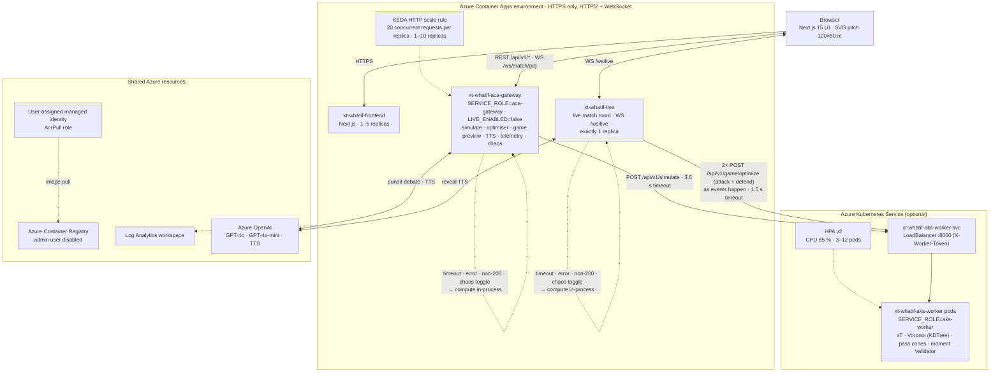

# ⚽ xT-WhatIf: Real-Time Counterfactual Football Intelligence

> **Interactive 360° Tactical Simulation & Dialectical Multi-Agent AI Swarm**  
> *Powered by a seeded synthetic 360-style match generator, Azure Container Apps (ACA), and Azure Kubernetes Service (AKS)*  
> Built for the **"Inside the Game" Hackathon** (Microsoft × Premier League). All match data is synthetic: fictional clubs, players and moments.

<!-- TODO: replace <FRONTEND_URL> and <GATEWAY_URL> with the deployment outputs (frontendUrl, gatewayUrl) and uncomment.
[](<FRONTEND_URL>)
[](<GATEWAY_URL>/docs)
-->

<!-- TODO: record a 4-5 s GIF (drag a player, the xT heatmap recalculates), save it as docs/demo.gif (< 5 MB) and uncomment.
<p align="center"></p>
-->

[](https://github.com/dbl04/xT-WhatIf/actions/workflows/deploy-azure.yml)
[](https://fastapi.tiangolo.com)
[](https://nextjs.org)
[](https://azure.microsoft.com/products/container-apps)
[](https://azure.microsoft.com/products/kubernetes-service)
[](https://opensource.org/licenses/MIT)

---

## 🎯 Executive Vision

**xT-WhatIf** transforms traditional post-match football analytics into an interactive, real-time counterfactual simulator. Instead of passively analyzing what happened, analysts and coaching staffs can **pause key match moments, drag and drop defenders or attackers on a canonical 120×80m pitch, and instantly recalculate tactical metrics**:
- **Expected Threat ($\Delta\text{xT}$)** on a $16 \times 12$ canonical transition matrix.
- **Spatial Dominance ($60 \times 40$)** through vector-accelerated Voronoi tessellations via `scipy.spatial.KDTree`.
- **Passing Lane Shadows** with dynamic Gaussian interception dispersion cones.
- **Dialectical AI Debate**: Two contrasting AI personas analyze the repositioned scenario:
  - 🤖 **Dr. Voronoi (`AI-QUANT`)**: Mathematical purist evaluating spatial EV, angular apertures, and threat deltas.
  - 📋 **Coach Bianchi (`PRO-COACH`)**: Seasoned tactician focusing on marking profiles, rest defense, and interior channel coverages.
- **Personalised storytelling**: the whole interface and both pundits speak **English or Spanish**, and the commentary is rewritten for four audiences (casual fan, analyst, coach, audio description). See *Personalisation: Language & Audience* below.

---

## 🏛️ System Architecture: Dual-Role Hybrid Cloud (ACA + AKS)

One backend image runs in several roles, selected by the `SERVICE_ROLE` environment variable. The same code runs as a single process locally and as separate services on Azure:



### How the pieces fit together
1. **One image, several roles.** The backend image is the same for the gateway (`aca-gateway`), the live match (`SERVICE_ROLE=live`, `LIVE_ENABLED=true`) and the AKS workers (`aks-worker`). Locally, `standalone` runs everything in one process.
2. **Event-by-event delegation with in-process fallback.** As synthetic match events happen in the live match (no look-ahead), the singleton `xt-whatif-live` service offloads the moment Validator's two independent searches (`optimize(frame, "attack")` and `optimize(frame, "defend")`) in parallel to the AKS worker pool (`POST /api/v1/game/optimize`, guarded by `X-Worker-Token`, 1.5 s timeout), while `xt-whatif-aca-gateway` forwards counterfactual simulations (`POST /api/v1/simulate`, 3.5 s timeout). If any call times out, fails or returns a non-200 status (or when the chaos toggle is active), the caller runs the same engine in-process and records a circuit-breaker trip.
3. **Scaling.** KEDA scales the gateway on concurrent HTTP requests and the HPA scales the AKS workers on CPU. The live match stays on one replica so every fan sees the same match state, while heavy Validator CPU searches scale across AKS pods.

---

## 🧮 Mathematical Engine Deep-Dive

### 1. Canonical Expected Threat (xT) Bilinear Interpolation
The field is partitioned into an $M \times N = 16 \times 12$ canonical grid ($C = 192$ zones) following Karun Singh's Markovian model. The expected threat for any continuous coordinate $(x, y) \in [0, 120] \times [0, 80]$ is computed using 2D bilinear interpolation:

$$\text{xT}(x, y) = \sum_{i=0}^{1} \sum_{j=0}^{1} \text{xT}_{c+i, r+j} \cdot \left(1 - \left|\frac{x - x_{c+i}}{\Delta x}\right|\right) \left(1 - \left|\frac{y - y_{r+j}}{\Delta y}\right|\right)$$

The counterfactual delta is given by:

$$\Delta \text{xT} = \text{xT}_{\text{simulated}} - \text{xT}_{\text{base}}$$

### 2. High-Speed Voronoi Space Control ($60 \times 40$ Fine Grid)
To capture spatial dominance in the final third ($x \in [60.0, 120.0]$, $y \in [0.0, 80.0]$), the engine discretizes the area into a $60 \times 40$ matrix ($2,400$ sample points) evaluated against all player coordinates $\mathbf{p}_k$ using `scipy.spatial.KDTree`:

$$\mathcal{V}_k = \left\{ \mathbf{q} \in \mathbb{R}^2 \mid \|\mathbf{q} - \mathbf{p}_k\|_2 < \|\mathbf{q} - \mathbf{p}_j\|_2, \; \forall j \neq k \right\}$$

$$\text{SpaceControl}_{\text{home}} = \frac{1}{|\mathcal{G}|} \sum_{\mathbf{q} \in \mathcal{G}} \mathbb{I}\left(\operatorname{argmin}_k \|\mathbf{q} - \mathbf{p}_k\|_2 \in \text{Team}_{\text{home}}\right) \times 100\%$$

*Performance: Sub-2ms vector execution across 2,400 query points.*

### 3. Gaussian Passing Shadow & Expected Value Maximization
Passing lanes are evaluated as a directional cone between ball holder $\mathbf{p}_{\text{ball}}$ and candidate receiver $\mathbf{p}_{\text{target}}$. The interception probability density by defender $\mathbf{d}_m$ at distance $d_{\perp}$ from the trajectory is modeled with distance-widening dispersion $\sigma(t) = \sigma_0 (1 + \alpha d_{\parallel})$:

$$P_{\text{intercept}}(\mathbf{d}_m) = \exp\left( -\frac{d_{\perp}(\mathbf{d}_m)^2}{2\,\sigma(d_{\parallel})^2} \right)$$

$$P_{\text{pass}} = \prod_{m \in \text{Defenders}} \left( 1 - P_{\text{intercept}}(\mathbf{d}_m) \right)$$

The engine dynamically recommends the **optimal alternative receiver** (`optimal_pass_target_id`) by maximizing Expected Value:

$$k^* = \operatorname{argmax}_{k \in \text{Teammates}} \left( P_{\text{pass}}(\mathbf{p}_k) \times \text{xT}(\mathbf{p}_k) \right)$$

### 4. Quadratic Physical Inertia Penalty
When a user drags a player beyond realistic reaction envelopes ($\Delta d > 6.0\,\text{m}$), a biomechanical recovery penalty is applied to avoid teleportation artifacts:

$$\text{Penalty}_{\text{inertia}} = \beta \cdot \max(0, \Delta d - 6.0)^2, \quad \beta = 0.008$$

$$\text{xT}_{\text{simulated}} = \max\left(0.02, \; \text{xT}_{\text{raw}} - \text{Penalty}_{\text{inertia}}\right)$$

---

## 🧪 Synthetic Match Data

All data is **synthetic and football-realistic**, generated by [`backend/app/services/synthetic_generator.py`](backend/app/services/synthetic_generator.py). No real clubs, players or match feeds are used.

- **Fixture:** Redmoor Albion vs Saltmarsh Rovers (fictional), match id `900001`, seed `7`. Same seed, same match.
- **Full freeze-frames:** all 22 players plus the ball in every moment, in 120×80 coordinates with the team in possession attacking towards x = 120.
- **Role-based shapes:** the attacking side sets up in a 4-3-3 (rest-defence centre-backs, high full-backs, wingers holding width, striker on the last line); the defending side in a compact 4-5-1 block that stays goal-side and shifts towards the ball.
- **Scenario templates:** wide carry, counter-attack through ball, cut-back, half-space pass, switch of play, edge-of-box shot and 1v1. Each fixes the ball path and which roles carry and receive.
- **Realistic details:** the nearest defender presses the carrier at an angle, the action is played through a gap (defenders are kept off the ball's path), Gaussian positional noise and a 1.8 m minimum spacing.
- **Consistent metrics:** xT, pass probability and space control are computed with the same engine used for counterfactuals, so an untouched moment always has ΔxT = 0.

Moments in the default match:

| # | Clock | Event | Moment | In possession | Base xT |
|:-:|:-----:|:-----:|:-------|:--------------|:-------:|
| **1** | **5:03** | Shot | Shot from the edge of the box | Saltmarsh Rovers (I. Kowalin) | 0.10 |
| **2** | **19:10** | Shot | One-on-one with the keeper | Saltmarsh Rovers (Z. Ombrell) | 0.11 |
| **3** | **37:09** | Pass | Switch of play to the far side | Redmoor Albion (D. Okonne) | 0.09 |
| **4** | **45:19** | Dribble | Wide carry into the box | Redmoor Albion (E. Adeyo) | 0.18 |
| **5** | **55:12** | Pass | Through ball into the half-space | Redmoor Albion (M. Ferrant) | 0.25 |
| **6** | **71:48** | Pass | Counter-attack: ball into space | Saltmarsh Rovers (I. Kowalin) | 0.22 |
| **7** | **86:56** | Pass | Cut-back from the byline | Saltmarsh Rovers (Y. Belcourt) | 0.17 |

Regenerate the committed fixtures (backend cache, frontend offline mocks and the offline narration for every language and audience) after changing the generator or the narration:

```bash
cd backend && python -m app.services.synthetic_generator --write
```

`backend/test_synthetic_generator.py` checks determinism, squad and pitch invariants, plausible metrics, and that the committed fixtures are up to date.

---

## 🗣️ Personalisation: Language & Audience

The challenge asks to *personalize* the explanation. xT-WhatIf does it on two axes, chosen at the top right of the dashboard and remembered per browser:

| Axis | Options | What changes |
|:-----|:--------|:-------------|
| **Language** | English (default) · Spanish | Every interface string, the moment names, both pundits' debate, the exported PNG report and the commentator voices (`en-GB` / `es-ES`). |
| **Audience** | Casual fan · Analyst (default) · Coach · Audio description | How the pundits explain the same numbers. |

- **Casual fan:** plain words, no jargon; xT is told as *"a 10% chance of leading to a goal"*.
- **Analyst:** full metrics — xT on the 16×12 grid, pass probability, Voronoi space control, coordinates.
- **Coach:** a verdict on the adjustment (*validated* / *rejected*) and one actionable coaching point.
- **Audio description:** spoken-first, spatial narration for blind and low-vision fans (*"on the right wing, about 25 metres from goal"*), no symbols or coordinates, read about 10% slower.

**Code calculates, AI explains.** All wording lives in [`backend/app/services/narration.py`](backend/app/services/narration.py) and is filled only with numbers computed by the engine. With Azure OpenAI configured, the same profile is turned into style instructions for GPT-4o, which is told to use only the numbers it is given; without it, the deterministic templates answer instantly.

API:

```bash
# Key moments with labels and pre-move debate in Spanish, for casual fans
curl "http://localhost:8000/api/v1/match/900001/frames?lang=es&audience=casual"

# Counterfactual with the debate written for coaches
curl -X POST http://localhost:8000/api/v1/simulate -H "Content-Type: application/json"   -d '{"match_id": 900001, "event_uuid": "...", "modified_players": [...], "language": "en", "audience": "coach"}'
```

The WebSocket takes the same profile as query parameters: `ws://localhost:8000/ws/match/900001?lang=es&audience=audio_description`. The TTS endpoint (`POST /api/v1/tts/synthesize`) accepts `language` and `audience` too.

---

## ⚡ Quickstart: Local Orchestration

### Prerequisites
- Docker & Docker Compose (or Python 3.11+ and Node.js 20+)

### Single-Command Boot
```bash
docker compose up --build
```

Access the applications:
- **Frontend Dashboard**: [http://localhost:3000](http://localhost:3000)
- **FastAPI Interactive Docs**: [http://localhost:8000/docs](http://localhost:8000/docs)
- **Live WebSocket**: `ws://localhost:8000/ws/match/900001`
- **Cloud Architecture Telemetry**: [http://localhost:8000/api/v1/cloud/telemetry](http://localhost:8000/api/v1/cloud/telemetry)

---

## 🧪 Interactive Telemetry & Chaos Engineering (For Judges)

The gateway exposes endpoints to inspect its state and to trigger the AKS fallback during a demo:

### 1. View Live Cluster Telemetry
```bash
curl http://localhost:8000/api/v1/cloud/telemetry
```
*Returns simulation counters, cache hit ratios, KEDA concurrency targets, and Circuit Breaker status. On Azure, the gateway replica count is read from Azure Monitor (`"simulated": false`); locally it is estimated. AKS pod and CPU figures are always estimated from the request load.*

### 2. Inject AKS Chaos Outage (Live Pitch Demo)
```bash
curl -X POST http://localhost:8000/api/v1/cloud/chaos-toggle
```
*Simulates an AKS outage. While it is on, the gateway and live match service skip the AKS call and compute every simulation and moment Validator search in-process, so client requests and live moments keep running without interruption. The flag switches itself off after 90 seconds (`CHAOS_AUTO_RESET_SECONDS`).*

### 3. Run KDTree Parallel Stress Burst (25 Parallel Simulations)
```bash
curl -X POST http://localhost:8000/api/v1/cloud/stress-burst
```
*Executes 25 parallel spatial simulations using `asyncio.gather`. Reports total elapsed time and throughput (>800 simulations/sec).*

---

## ☁️ Azure Cloud Native Integration

This is the project's entry for the **Best Azure Cloud Native Integration** category, which the [official rules](https://github.com/microsoft/insidethegamehackathon/blob/main/OFFICIAL%20RULES.md) describe as the use of *"Azure cloud-native services (AKS, Azure Container Apps, Functions, Logic Apps, and AI-optimized data platforms)"*.

### Technologies named in the hackathon rules

| Technology | Where the rules name it | How xT-WhatIf uses it | Status |
|:-----------|:------------------------|:----------------------|:-------|
| **Azure Container Apps** | Cloud Native category | Hosts the frontend, the API gateway (scaled by KEDA, 1–10 replicas) and the live match service (1 replica). | Deployed by the Bicep template |
| **Azure Kubernetes Service (AKS)** | Cloud Native category | Runs geometry and optimiser workers (`SERVICE_ROLE=aks-worker`) behind a LoadBalancer service guarded by `X-Worker-Token`, scaled by an HPA from 3 to 12 pods. **As synthetic match events happen in real time** (no look-ahead), the singleton `xt-whatif-live` service offloads the moment Validator's `attack` and `defend` searches in parallel (`POST /api/v1/game/optimize`, 1.5 s timeout) to the AKS worker pool, and the gateway offloads counterfactual simulations (`POST /api/v1/simulate`). If AKS times out, fails or chaos mode is toggled on, both services fall back to in-process computation with identical results. | Optional: the manifest and the CI step are ready; they run when `AKS_ENABLED` is set and both backend apps receive `aksWorkerUrl` and `aksWorkerToken` |
| **Azure AI Services: Azure OpenAI** | Judging criteria (*"Azure Apps and AI Services"*) | GPT-4o and GPT-4o-mini write the two pundits' debate using function calling: the model calls the engine's tools (`simulate_counterfactual`, `optimizer/solve`, `xt_at`) and a deterministic verifier checks every figure in the text against the engine's output, correcting it or falling back to the template text if a number does not match. `gpt-4o-mini-tts` gives each pundit a voice. Without a key, deterministic templates and the browser's speech engine are used instead. | Used when the Azure OpenAI key and endpoint are configured |
| **MCP (Model Context Protocol)** | Judging criteria (*"Azure MCP"*) | The project ships its own MCP server, which exposes the engine's four tools to any MCP client over stdio (`python -m app.mcp`). It is not the Azure MCP Server product. | In the repo; runs locally |

### Supporting Azure services

| Service | How xT-WhatIf uses it |
|:--------|:----------------------|
| **Azure Container Registry** | Stores the backend and frontend images, tagged with the commit SHA. The admin user is disabled. |
| **Managed Identity + Azure RBAC** | A user-assigned managed identity with the `AcrPull` role on the registry lets the Container Apps pull images without a registry password. The same identity holds `Monitoring Reader` on the gateway to read its metrics. |
| **Log Analytics** | Receives the container logs of the Container Apps environment. |
| **Azure Monitor** | `GET /api/v1/cloud/telemetry` reads the gateway's `ReplicaCount` metric from Azure Monitor with the managed identity, so `aca_gateway_replicas` shows how many replicas KEDA is running (`"simulated": false` in the response). Locally, or if the query fails, it falls back to an estimate and returns `"simulated": true`. |
| **Bicep (Azure Resource Manager)** | Describes every Azure resource above in one template ([`infra/main.bicep`](infra/main.bicep)). |

### How the category's criteria map to the project

The rules ask for *"effective integration of Azure services, event-driven architectures, automation, operational excellence, and AI capabilities"*:

- **Scalable:** KEDA scales the gateway on concurrent HTTP requests; the HPA scales the AKS workers on CPU.
- **Resilient:** the gateway and live match service fall back to in-process computation when the AKS workers fail, and health probes restart or hold back unhealthy containers.
- **Event-driven:** as each synthetic match event arrives in real time, the live runner triggers parallel `attack` + `defend` Validator searches on AKS and pushes match events, key moments and reveals to every fan over WebSockets.
- **Automation:** one Bicep template and one GitHub Actions workflow build, tag and deploy everything.
- **Operational excellence:** a new Container Apps revision per commit SHA, health probes, central logs, per-client rate limits and hardened containers.
- **AI capabilities:** Azure OpenAI with tool calling and number verification, and Azure OpenAI TTS.

### Implementation details

Each row describes what is deployed and links to the file that defines it.

| Area | What is deployed | Defined in |
|:-----|:-----------------|:-----------|
| **Compute** | Three Container Apps in one managed environment: `xt-whatif-frontend` (1–5 replicas), `xt-whatif-aca-gateway` (1–10 replicas) and `xt-whatif-live` (exactly 1 replica, holds the shared live match). | [`infra/main.bicep`](infra/main.bicep#L181) |
| **Autoscaling** | The gateway uses a KEDA HTTP scale rule with a target of 20 concurrent requests per replica. The optional AKS workers use an HPA v2 targeting 65 % CPU, from 3 to 12 pods. | [`main.bicep`](infra/main.bicep#L240), [`k8s-aks-workers.yaml`](infra/k8s-aks-workers.yaml#L144) |
| **Fallback** | When `aksWorkerUrl` is set, the live match service offloads the two Validator searches (`POST /api/v1/game/optimize` for `attack` and `defend` in parallel, 1.5 s timeout, authenticated with `X-Worker-Token`) as candidate events happen, and the gateway calls `POST /api/v1/simulate` (3.5 s timeout). On timeout, connection error, non-200 status or bad payload, they run the engine in-process and increment `circuit_breaker_trips`. | [`aks_client.py`](backend/app/services/aks_client.py), [`game_api.py`](backend/app/services/game_api.py), [`main.py`](backend/app/main.py#L163) |
| **Chaos toggle** | `POST /api/v1/cloud/chaos-toggle` forces the fallback path on both the gateway and the live match service. It resets itself after 90 s and is rate-limited to 12 calls per client per minute. | [`main.py`](backend/app/main.py#L276), [`rate_limit.py`](backend/app/core/rate_limit.py#L24) |
| **Registry & identity** | Azure Container Registry with the admin user disabled. All three apps pull images with a user-assigned managed identity that holds the `AcrPull` role, so no registry password is stored. | [`main.bicep`](infra/main.bicep#L54) |
| **Secrets** | The Azure OpenAI key and `AKS_WORKER_TOKEN` are Container Apps secrets referenced by the apps (`secretRef`) and Kubernetes secrets on AKS (`aks-worker-token`). Without an OpenAI key, the app uses deterministic templates. | [`main.bicep`](infra/main.bicep#L121), [`k8s-aks-workers.yaml`](infra/k8s-aks-workers.yaml#L73) |
| **Ingress** | External HTTPS only (`allowInsecure: false`), `transport: auto` for HTTP/2 and WebSockets. Backend CORS accepts only the frontend's own address. | [`main.bicep`](infra/main.bicep#L49) |
| **Container hardening** | Both images run as a non-root user. AKS worker pods also run with UID 10001, a read-only root filesystem, all Linux capabilities dropped, no privilege escalation and the `RuntimeDefault` seccomp profile; `/tmp` and the cache folder are `emptyDir` volumes. | [`backend/Dockerfile`](backend/Dockerfile#L23), [`frontend/Dockerfile`](frontend/Dockerfile#L52), [`k8s-aks-workers.yaml`](infra/k8s-aks-workers.yaml#L38) |
| **Health checks** | Liveness and readiness probes on `/health` for both backend Container Apps and the AKS pods. AKS rolls out with `maxUnavailable: 0`. | [`main.bicep`](infra/main.bicep#L157), [`k8s-aks-workers.yaml`](infra/k8s-aks-workers.yaml#L26) |
| **Logs** | The Container Apps environment sends container logs to a Log Analytics workspace. In `/api/v1/cloud/telemetry` the gateway replica count comes from Azure Monitor; the AKS pod count and CPU figures are estimated from request load. | [`main.bicep`](infra/main.bicep#L89), [`cloud_telemetry.py`](backend/app/services/cloud_telemetry.py) |
| **Infrastructure as Code** | Bicep creates the registry, identity, role assignment, Log Analytics, the environment and the three apps, and outputs their URLs. A Kubernetes manifest defines the AKS namespace, deployment, LoadBalancer service and HPA. | [`infra/`](infra/) |
| **CI/CD** | [`deploy-azure.yml`](.github/workflows/deploy-azure.yml) runs the backend tests, a TypeScript check and a Next.js build on every push and pull request. A manual run builds both images, tags them with the commit SHA, pushes them to ACR, deploys the Bicep template and, if `AKS_ENABLED` is set, syncs the `aks-worker-token` secret and applies the AKS manifest with the same tag. Each deploy creates a new Container Apps revision. | [`.github/workflows/`](.github/workflows/) |
| **MCP server** | A Model Context Protocol server (JSON-RPC 2.0, stdio) exposes the engine to external AI agents as four tools: `simulate_counterfactual`, `optimizer/solve`, `xt_at` and `what_if_natural_language`. Start it with `python -m app.mcp` from `backend/`. | [`backend/app/mcp/server.py`](backend/app/mcp/server.py) |

Setup, delivery-day steps, smoke tests and the load test are in **[docs/DEPLOY.md](docs/DEPLOY.md)**.

Rehearse the same layout locally:
```bash
docker compose up --build
```

Load-test the live match with real WebSocket fans (from `backend/`):
```bash
python scripts/live_load_test.py --url ws://localhost:8001 --fans 300 --duration 120
```

---

## 🧪 Test Suite Execution

```bash
# Synthetic data generator
python backend/test_synthetic_generator.py

# Personalised narration (language x audience) and TTS
python backend/test_narration.py
python backend/test_tts_service.py

# Game engine & live match (including AKS Validator offload & circuit breaker)
python backend/test_game_engine.py
python backend/test_live_match.py

# Public demo guardrails (rate limits, input bounds, chaos auto-reset)
python backend/test_hardening.py

# Run Phase 2: Tactical Math & Agent Swarm
python backend/test_phase2.py

# Run Phase 3 & 4: Cloud Dual-Role, Circuit Breaker & Chaos Telemetry
python backend/test_phase3_cloud.py
```

All test suites run in GitHub Actions on every Pull Request and Push to `main`.

---

## 👥 Contributors & Hackathon Team
- **"Inside the Game" Hackathon Team** — October 2026.
- Powered by synthetic match data & Microsoft Azure Cloud.
